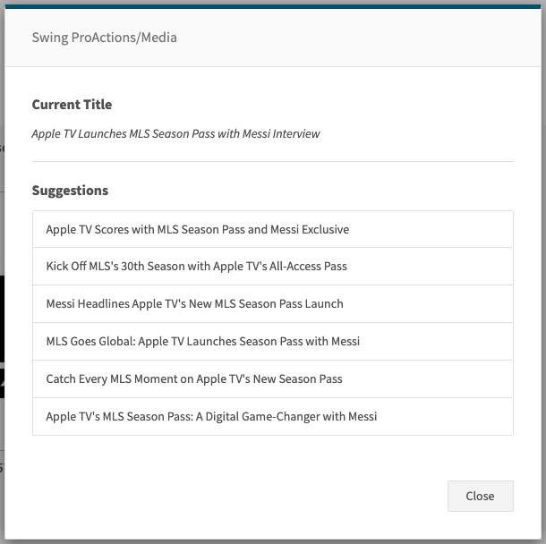

# USER_SELECT

Displays a selection modal allowing the user to pick one item from a list. The list may be provided directly or produced by a pre-processing step (inlineSteps). The selected value is written to the default text output.

## Images


## At a glance
- **Category** UI
- **Version:** 1.0.0
- **Applications:** all
- **Scope:** all

## When to Use

Use **USER_SELECT** when a user must choose one textual value from a prepared list or text-derived list.

## Data Flow

Reads `list`, or converts `text` when list is absent; resolves prompt and info values. Writes the selected value to `text` or its configured output name; inline steps may also write context. With applySteps, each clicked option is applied by running applySteps on a copy of the flow context (option in the text output); Done writes the applied option to the text output, while "Restore original" and Cancel re-apply restoreValue.

## Config Options
| Name | Description | Default | Required | Resolved | Constraints | Conditional Rules |
|---|---|:---:|:---:|:---:|---|---|
| `inlineSteps` | Optional steps to execute before showing the selection modal. Useful to prepare or transform input. | None |false| false |None|None|
| `promptText` | Prompt or title text shown at the top of the selection modal (supports variable resolution). | None |false| true |None|None|
| `infoTitle` | Optional title shown above additional info in the selection modal. | None |false| true |None|None|
| `infoText` | Optional descriptive text shown in the selection modal (supports variable resolution). | None |false| true |None|None|
| `enableKeyboardControl` | Enable keyboard navigation in the selection modal. | None |false| false |None|None|
| `applySteps` | Enables try-out mode: steps run each time the user clicks an option, with the option in the text output. The dialog stays open; Done accepts the applied option and continues the flow. Requires restoreValue. | None |false| false |None|Requires: restoreValue|
| `restoreValue` | Required with applySteps: the original value (supports variable resolution), resolved when the dialog opens. Backs the "Restore original" button and is re-applied via applySteps when the user cancels, so no tried option is left in the document. | None |false| true |None|None|

## Inputs
| Type | Description | Default | Required | Resolved |
|---|---|:---:|:---:|:---:|
| `list` | List of options for the user to select from. If omitted, converts text input to a list automatically. | None | false | false |

## Outputs
| Type | Description | Optional |
|---|---|:---:|
| `text` | The selected option (string) stored in the default text output. | false |

## Examples

### Simple selection from a list
```yaml
- step: USER_SELECT
  promptText: "Choose an option"
  # list can be taken from prior steps or from the flowContext
```

### Selection with inline list generation
```yaml
- step: TO_LIST
  # prepare list in flowContext.list

- step: USER_SELECT
  inlineSteps:
    - step: TO_LIST
```

### Try suggestions in the document before accepting
```yaml
- step: USER_SELECT
  inlineSteps:
    - step: HUB_COMPLETION
      instruction: "Suggest 6 headlines for: {textContent}"
      response_format: list
  enableKeyboardControl: true
  promptText: Suggestions
  infoTitle: Current Title
  infoText: '{{ client.getTextAtXpath("/doc/story/grouphead/headline/p") | safe }}'
  restoreValue: '{{ client.getTextAtXpath("/doc/story/grouphead/headline/p") | safe }}'
  applySteps:
    - step: REPLACE_TEXT
      at: XPATH
      xpath: "/doc/story/grouphead/headline/p"
```

## See Also

**General Resources:**

- [Step Library Overview](../overview.md)
- [Configuration Basics](../../guides/configuration/basics.md)
- [Examples](../../guides/examples/headline-suggestions.md)
